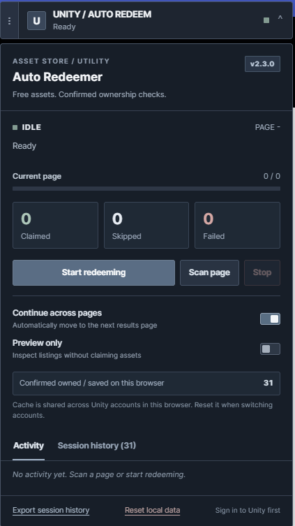

# Unity Asset Redeemer

Unity Asset Redeemer is a userscript for reviewing and claiming free listings on the Unity Asset Store. It keeps the existing Unity authentication flow, processes listing pages conservatively, remembers confirmed ownership locally, and presents progress in a compact slate dashboard.

Current version: **2.3.1**

## Install

[**Install Userscript**](https://raw.githubusercontent.com/PatrickJnr/Unity-Asset-Redeemer/main/Unity_Auto_Redeemer.user.js)

1. Install a userscript manager. [Tampermonkey](https://www.tampermonkey.net/) is the primary supported manager. [Violentmonkey](https://violentmonkey.github.io/) is expected to work with the standard metadata used here, but releases are validated primarily with Tampermonkey.
2. Open the **Install Userscript** link above.
3. Review the source and confirm the installation prompt.
4. Sign in at [Unity Asset Store](https://assetstore.unity.com/), open a listing page, and expand the **Unity / Auto Redeem** panel.

The script runs only on `https://assetstore.unity.com/*`. It has `@grant none`, makes same-origin requests through the signed-in Unity page, and does not include credentials.

## Features

- Detects free listing cards and excludes cards with a paid price.
- Skips cards that Unity visibly marks as owned.
- Uses Unity's existing `addToDownload` GraphQL operation with the current session and CSRF cookie.
- Validates product IDs, HTTP status, JSON, GraphQL errors, and the returned product ID before recording a claim.
- Retries temporary network, rate-limit, and server failures up to two times with bounded delays, then stops the run.
- Processes numbered or arrow-based pagination and waits for listing content to change.
- Stops on repeated pages, failed navigation, a configurable safety limit, or user request.
- Stores up to 20,000 confirmed owned product IDs in browser local storage.
- Provides preview, activity, searchable session history, JSON export, and local-data reset controls.
- Uses a movable, collapsible Shadow DOM dashboard with keyboard focus indicators and reduced-motion support.

## Screenshot



## Usage

Open a Unity Asset Store search, category, or sale listing. The dashboard appears at the upper-right. Use **Scan page** to inspect detected free candidates without sending a claim. Enable **Preview only** and press **Start redeeming** to exercise the full page and pagination flow without claiming.

With preview disabled, **Start redeeming** processes each free candidate in sequence. **Stop** aborts the active request where possible and prevents further requests. A request already received by Unity may still complete.

### Automatic pagination

**Continue across pages** is enabled by default. The script supports listing pages containing up to 96 items and searches for explicit Next controls, accessible labels, common arrow icons, or the next numbered control. It waits for a stable content change before processing another page. Repeated pages and navigation timeouts stop the run instead of looping.

### Ownership data

Unity-owned controls such as **Open in Unity**, **Import**, and **Download** are excluded before claiming. A successful claim or Unity's explicit already-owned response is added to a persistent local cache. Failed and unknown outcomes are not marked as owned.

The cache belongs to the browser profile, not a Unity account. If you switch Unity accounts, select **Reset local data** before running. Resetting removes only this script's local cache and current-tab history. It does not alter the Unity library.

## Automatic updates

Tampermonkey and compatible managers compare the script's semantic `@version` with the metadata served from the repository's `main` branch. `@updateURL` and `@downloadURL` both use the canonical root `.user.js` file. Update checks occur according to each manager's settings, so a published update may not appear immediately.

Older installations named **Unity Asset Store Auto Redeemer (Fixed)** use a different name and namespace and do not contain these update URLs. Install this version, then disable or remove the older entry to prevent both scripts from running on the same page. Local ownership data uses the existing storage keys and remains available in the same browser profile and origin.

For maintainers, publish an update in this order:

1. Make and review code changes.
2. Run `npm ci` and `npm run validate`.
3. Increase `@version` and `package.json` using semantic versioning.
4. Update `CHANGELOG.md`.
5. Commit and push to `main`.
6. Create a matching `vX.Y.Z` GitHub release.
7. Verify the raw userscript contains the new version.

Do not reuse a released version number. Use a patch for fixes, a minor version for backward-compatible features, and a major version for breaking changes.

## Troubleshooting

- **No candidates appear:** Wait for the listing to finish loading, confirm that visible cards say **Free**, and try **Scan page**. Unity markup changes may require a selector update.
- **No CSRF cookie / authentication error:** Sign in again, accept any current Unity terms, refresh the listing, and retry.
- **Rate limit or server error:** The script waits for `Retry-After` values up to 60 seconds. For longer waits or exhausted retries it stops; wait for Unity's requested interval before starting again.
- **Pagination stops early:** The activity log explains whether the Next control was missing, navigation timed out, or a page repeated.
- **Assets are skipped after changing accounts:** Reset local data because the confirmed-owned cache is shared across Unity accounts in the browser profile.
- **Duplicate dashboard or requests:** Disable the previous userscript installation after migrating.

## Known limitations

- Unity can change its private storefront markup or GraphQL operation without notice.
- The script depends on an authenticated browser session and readable same-origin CSRF cookie.
- Visible owned detection depends on the action labels rendered by Unity.
- The persistent ownership cache is local and account-agnostic.
- Automated tests use mocked page markup and network behavior. They do not perform live redemptions.
- Violentmonkey compatibility is not exercised by the automated test suite.

## Development

Node.js 20 or later is required for validation. Runtime use of the userscript has no npm dependency.

```console
npm ci
npm run validate
```

The test suite uses jsdom only during development to exercise filtering, ownership detection, duplicate handling, response parsing, pagination guards, storage reset, ID validation, and metadata. GitHub Actions never contacts Unity or uses account secrets.

See [CONTRIBUTING.md](CONTRIBUTING.md) before submitting a change.

## Licence and attribution

This modified derivative is licensed under [Creative Commons Attribution-NonCommercial-ShareAlike 4.0 International](LICENSE). CC BY-NC-SA 4.0 is not an OSI-approved open-source licence and restricts commercial use.

CreosB created the original [Game Asset Auto Redeemer](https://github.com/creosB/Game-Asset-Auto-Redeemer). Patrick Jr. maintains this derivative. See [ATTRIBUTION.md](ATTRIBUTION.md) for provenance, modifications, and the upstream contact request. The original creator has not endorsed this fork.
